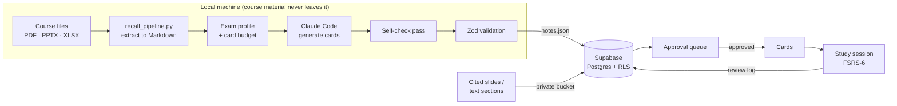

# Recall

**Spaced repetition for university courses: AI-drafted flashcards, human-approved, scheduled with FSRS.**

Recall turns lecture slides into exam-focused flashcards and schedules them with the
[FSRS](https://github.com/open-spaced-repetition/ts-fsrs) algorithm, the same scheduler Anki offers.
A local pipeline extracts course material and drafts cards with Claude Code; nothing reaches
the study deck until it has been reviewed in an approval queue. The app runs as a progressive web
app on phone and laptop with a shared learning state.

> The user interface is in German. The code, the data model and this README are in English.

<p>
  
  
  
  
  
</p>

---

## Contents

- [Why Recall](#why-recall)
- [Features](#features)
- [How it works](#how-it-works)
- [Tech stack](#tech-stack)
- [Getting started](#getting-started)
- [Creating cards](#creating-cards)
- [Deployment](#deployment)
- [Testing](#testing)
- [Project structure](#project-structure)
- [Data protection and course material](#data-protection-and-course-material)
- [Roadmap](#roadmap)

## Why Recall

Generic flashcard apps leave two problems open: writing good cards takes hours, and AI-generated
decks grow faster than anyone can review them. Recall addresses both:

- **Time budget first.** Every card creates reviews for months. The pipeline derives a card budget
  from the daily study time (about 15–20 new cards per day across all courses) and prioritises by
  an exam profile instead of turning every slide into cards.
- **Understanding over recall.** A fixed card mix: why/how questions, single-gap clozes for
  formulas and definitions, worked problems with original numbers, and image-occlusion cards.
  Clozes that can be guessed from grammar or contain several gaps are rejected automatically.
- **Human in the loop.** AI drafts are flagged by a second self-check pass and only become cards
  after approval. Rejection reasons flow back into the generation prompt.
- **Every card is traceable.** Each card cites its slide; one tap shows the full slide or the
  quoted text section.

## Features

| Area | What it does |
| --- | --- |
| Study session | FSRS-6 scheduling (Again / Hard / Good / Easy) with the next interval under each button, learning steps, daily limits, ordering by exam date and course priority, keyboard shortcuts |
| Card types | Why/how (free answer), cloze with KaTeX formulas, worked problems, image occlusion on slides |
| Approval queue | Accept, edit or reject with a reason (`A` / `E` / `R`), bulk accept, self-check hints per card |
| Sources | "Show source" reveals the complete cited slide(s) or the quoted text section, loaded on demand |
| Offline resilience | Reviews are queued locally and synced idempotently once the connection returns |
| Statistics | True retention vs. target, review forecast, daily study time, approval rate of AI cards |
| Courses | Exam date and type, priority, own cards, pause or delete notes, JSON backup |
| PWA | Installable on the iPhone home screen, dark mode, safe-area aware layout |

## How it works



- **Notes and cards are separate.** A note holds the content, a card holds the learning state.
  A cloze note produces one card per gap; only approved notes generate cards (enforced by a
  database trigger).
- **Reviews are written atomically.** A single RPC stores the new card state and an append-only
  review log in one transaction. The log is never modified and later allows FSRS parameter
  optimisation on personal data.
- **No custom backend.** The web app talks to Supabase directly; Row Level Security restricts
  every row and every stored file to its owner. Sign-up is limited to an allow-list of e-mail
  addresses.

## Tech stack

| Layer | Choice |
| --- | --- |
| Frontend | Next.js 16 (App Router, React Compiler), React 19, TypeScript (strict), Tailwind CSS 4 |
| Scheduling | [ts-fsrs](https://github.com/open-spaced-repetition/ts-fsrs) 6, FSRS-6 model |
| Backend | Supabase: Postgres, Auth (e-mail + password), Storage, RPC, Row Level Security |
| Validation | Zod schema shared by the app and the pipeline (`packages/schema`) |
| Math | KaTeX |
| Pipeline | Python (PyMuPDF, python-pptx, openpyxl) and TypeScript CLIs, card generation with Claude Code |
| Tests | Vitest (unit), Playwright (end-to-end against a local Supabase stack) |
| Hosting | Vercel (app), Supabase Cloud (database and private storage) |

## Getting started

### Prerequisites

- Node.js 24+ and pnpm 9+
- Docker Desktop (for the local Supabase stack)
- Python 3.12+ (only for the card pipeline)

### Local setup

```bash
git clone <this-repository> recall
cd recall
pnpm install

# Allow your e-mail address to sign up locally
cp supabase/seed.local.example.sql supabase/seed.local.sql   # then edit the address

# Start the local Supabase stack (Postgres, Auth, Storage) and apply all migrations
pnpm db:start

# Point the app at the local stack
cp apps/web/.env.example apps/web/.env.local                 # paste the publishable key from `pnpm db:status`

pnpm dev                                                     # http://localhost:3000
```

Sign up with the allowed address and a password (at least 10 characters). Locally no
confirmation e-mail is required.

### Useful commands

| Command | Purpose |
| --- | --- |
| `pnpm dev` / `pnpm build` | Run or build the web app |
| `pnpm db:start` / `pnpm db:stop` | Start or stop the local Supabase stack |
| `pnpm db:reset` | Rebuild the local database from migrations (deletes local data) |
| `pnpm lint` / `pnpm typecheck` | ESLint and TypeScript across the workspace |
| `pnpm test` / `pnpm test:e2e` | Unit tests / end-to-end tests |

## Creating cards

The pipeline runs locally. Course files live in `kurse/<course>/<week>/`, which is excluded from
Git (see [Data protection](#data-protection-and-course-material)).

```bash
# One-time: Python environment for extraction
python -m venv pipeline/.venv
pipeline/.venv/Scripts/python -m pip install -r pipeline/requirements.txt   # macOS/Linux: pipeline/.venv/bin/python
```

1. **Extract** slides, sheets and notes to Markdown with slide numbers:
   `pipeline/.venv/Scripts/python pipeline/recall_pipeline.py extract "kurse/<course>"`
2. **Profile and generate** in Claude Code with the project commands `/pruefungsprofil kurse/<course>`
   and `/karten kurse/<course>`. Rules, card mix and budget live in versioned prompts under
   `pipeline/prompts/`.
3. **Validate** against the shared schema: `pnpm cards:validate "<file>.notes.json"` (reports the card mix
   and flags answers that are too long).
4. **Image cards and sources:** `pnpm cards:bild <spec.json>` renders the required slides and computes
   the occlusion from the PDF text layer; `pnpm cards:quellen <notes.json>` prepares the cited slides
   and text sections; `pnpm cards:upload-images <notes.json> --linked` uploads them to private storage.
5. **Import** as drafts: `pnpm cards:import "<file>.notes.json" --linked`, then review them in the app.
6. **Feedback loop:** `pnpm cards:feedback` writes rejection reasons into the prompt context.

Commands with `--linked` use the Supabase CLI login, so no service-role key has to be stored in a file.

## Deployment

1. Create a Supabase project, then `pnpm exec supabase link` and `pnpm exec supabase db push --linked`.
2. Copy `supabase/.env.example` to `supabase/.env` and set the app URL. The cloud auth settings in
   `supabase/config.toml` (`[remotes.production]`) read it; check with `pnpm exec supabase config diff`
   and apply with `pnpm exec supabase config push`.
3. Add your e-mail address to `public.allowed_emails` in the cloud database.
4. Deploy the web app to Vercel with root directory `apps/web` and the environment variables
   `NEXT_PUBLIC_SUPABASE_URL` and `NEXT_PUBLIC_SUPABASE_ANON_KEY` (publishable key).
   `.vercelignore` keeps course material and local files out of every upload.
5. On the iPhone: open the app in Safari, Share → "Add to Home Screen", sign in once.

Backups: `scripts/backup.ps1 -Linked` dumps all data (including the auth user) and keeps the last 30.

## Testing

- **Unit tests (Vitest):** FSRS reference intervals, queue ordering and daily limits, the offline
  review outbox, Markdown and cloze rendering (including HTML escaping), and the import schema.
- **End-to-end tests (Playwright, desktop and mobile viewport):** sign-up restrictions, password
  login, import → approval → 20-card study session → statistics, offline reviews and resync,
  bulk approval, image occlusion, "show source" and storage access rules.

```bash
pnpm db:start
pnpm test
pnpm test:e2e
```

## Project structure

```
apps/web/            Next.js app (pages, components, FSRS adapter, queue, rendering, offline outbox)
packages/schema/     Zod schema for card JSON, shared by app and pipeline
pipeline/            Extraction (Python), image-card and source tooling, TypeScript CLIs, prompts
supabase/            Migrations (single source of truth for the schema), config, seeds
scripts/             Backup script
.claude/commands/    Claude Code project commands for profiling and card generation
CLAUDE.md            Conventions and architecture notes for AI-assisted development
```

## Data protection and course material

Course material is copyrighted by the respective university and is **never** part of this
repository:

- `kurse/` (slides, extracts, rendered images, exam profiles, generated cards), PDFs, PPTX and
  XLSX files are excluded via `.gitignore`; `.vercelignore` excludes them from deployments.
- All secrets live in `.env` files that are ignored; only `*.env.example` templates with placeholders
  are committed. The web app only ever uses the public (publishable) Supabase key.
- In the cloud, card texts are the user's own formulations with source references. Only individual
  slides that a card cites or occludes are stored, in a private bucket that only the owner can read,
  via short-lived signed URLs. Complete documents are never uploaded.

## Roadmap

- Exercise mode with AI feedback and a mistake log
- FSRS parameter optimisation on the personal review log
- Anki import and export (`.apkg`)

## License

No license is granted. The code is published for reference; all rights are reserved.

---

Built with [Claude Code](https://claude.com/claude-code).
